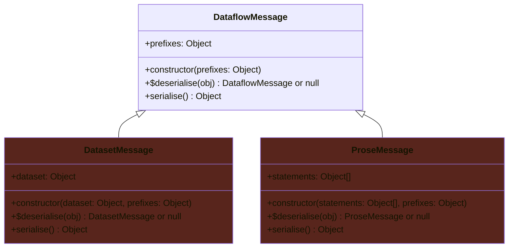

<p align="left">
<a href="https://www.w3.org/TR/rdf12-concepts/" target="_blank" rel="noreferrer"></a>
</p>

# RDF Dataflow

**RDF Dataflow** (or **Dataflow** for short) is a JSON-based message format for [RDF-star](https://graphdb.ontotext.com/documentation/11.3/rdf-sparql-star.html), which is a superset of [RDF 1.1](https://www.w3.org/TR/2014/REC-rdf11-concepts-20140225/).

RDF has a dual purpose here:

- _Data_ — It's a way of representing (semantic) data. This is the original purpose of RDF.
- _A language for machines_ — `RDF Dataflow` breaks new ground by introducing the **RDF as language** concept. RDF can serve as a new language for machines and software, mainly for those that have AI/LLM capabilities, but not only. Indeed, an RDF statement can be seen as being structured as a subject+verb+object triple, and can be converted to a human language.

Dataflow 2.x fully supports both uses of RDF:

- **Dataset mode** — A Dataflow message can contain an RDF dataset where the order of statements is not significant, and where duplicate statements are just a waste of bandwidth.
- **Prose mode** — A Dataflow message can contain prose whereby machines communicate with each other. The main use case is AI-to-AI communication. Such a message is structured as an ordered array of RDF statements, where the duplication of statements is significant.

## The Dataflow format

- `types.mts` describes this format.
- The content type for Dataflow messages is `application/x-rdfdataflow+json`.
- The file extension for Dataflow files is `.rdfdataflow.json`.

## Sample Dataflow messages

### A simple message containing a dataset

"<https://site.example/#jim>'s name is Jim."

```json
{
  "rdfdataflow": { "version": "2.0" },
  "dataset": [
    [
      { "type": "iri", "value": "https://site.example/#jim" },
      { "type": "iri", "value": "https://schema.org/givenName" },
      { "type": "literal", "value": "Jim" }
    ]
  ]
}
```

### A message containing a more complex dataset

Contains a statement about a statement: "<https://site.example/#xyz>'s name is Xyz. <https://site.example/#xyz>'s name is Xyz since 1999-12-25."

```json
{
  "rdfdataflow": { "version": "2.0" },
  "head": {
    "prefixes": {
      "ex"    : "https://site.example/",
      "schema": "https://schema.org/",
      "xsd"   : "http://www.w3.org/2001/XMLSchema#"
    }
  },
  "dataset": [
    [
      { "type": "iri", "value": "ex:xyz" },
      { "type": "iri", "value": "schema:givenName" },
      { "type": "literal", "value": "Xyz", "language": "tr" }
    ],
    [
      {
        "type": "triple",
        "value": [
          { "type": "iri", "value": "ex:xyz" },
          { "type": "iri", "value": "schema:givenName" },
          { "type": "literal", "value": "Xyz", "language": "tr" }
        ]
      },
      { "type": "iri", "value": "ex:since" },
      { "type": "literal", "value": "1999-12-25", "datatype": "xsd:date" }
    ]
  ]
}
```

### A message containing prose

"<https://site.example/jimbo>'s name is Jim Bo. <https://site.example/jimbo>'s mailbox is `mailto:jim.bo@site.example`."

```json
{
  "rdfdataflow": { "version": "2.0" },
  "head": {
    "prefixes": {
      "ex"  : "https://site.example/",
      "foaf": "http://xmlns.com/foaf/0.1/",
      "xsd" : "http://www.w3.org/2001/XMLSchema#"
    }
  },
  "prose": [
    [
      { "type": "iri", "value": "ex:jimbo" },
      { "type": "iri", "value": "foaf:name" },
      { "type": "literal", "value": "Jim Bo" }
    ],
    [
      { "type": "iri", "value": "ex:jimbo" },
      { "type": "iri", "value": "foaf:mbox" },
      { "type": "literal", "value": "mailto:jim.bo@site.example", "datatype": "xsd:anyURI" }
    ]
  ]
}
```

## Dataflow compared to other RDF formats

`RDF Dataflow` is suitable whenever:

- RDF-star support is required, in particular whenever making statements about statements should be possible.
- Serialisers and deserialisers should be easy to implement.
- Document completeness (= non-truncation) should be easy to verify by examining the document contents.

Where the other RDF formats are currently falling short:

- `RDF Dataflow` breaks new ground with its prose mode. All the other RDF formats are only geared toward representing data.

- The [SPARQL 1.1 Query Results JSON Format](https://www.w3.org/TR/sparql11-results-json/) does not support RDF-star, and its purpose is to serialise many types of SPARQL results, not only RDF datasets. `RDF Dataflow` is derived from this format.

- [JSON-LD](https://www.w3.org/TR/json-ld11/) is another JSON-based format. This format ensures non-truncation, and [RDF-star support is in the works](https://json-ld.github.io/json-ld-star/), but this is a terse and human-unfriendly format for which serialisers and deserialisers are non-trivial to program.

- [Turtle](https://www.w3.org/TR/rdf12-turtle/) and [TriG](https://www.w3.org/TR/rdf12-trig/) support RDF-star, but  writing serialisers and deserialisers for those formats is non-trivial, and they make it impossible to ensure that a document hasn't been truncated, unless a special vocabulary such as [qrmm](https://vocab.qworum.net/#qrmm) is used to ensure content integrity.

- [N-Quads](https://www.w3.org/TR/rdf12-n-quads/) and [N-Triples](https://w3c.github.io/rdf-n-triples/spec/) support RDF-star, but writing serialisers and deserialisers for those formats is somewhat more difficult than for `RDF Dataflow`, and these formats also make it impossible to ensure that a document hasn't been truncated, unless a special vocabulary such as [qrmm](https://vocab.qworum.net/#qrmm) is used to ensure content integrity.

## Exported classes

Exported classes.



## How it works

This software library converts between:

- serialised `RDF Dataflow` messages
- in-memory `RDF Dataflow` messages
- in-memory `RDF` that is conformant with [the RDF/JS: Dataset specification 1.0](https://rdf.js.org/dataset-spec/#dataset-interface) and [the RDF/JS: Data model specification](https://rdf.js.org/data-model-spec/#quad-interface)

The following steps are out of scope for this library, and that's where the [N3.js](https://github.com/rdfjs/N3.js) library comes in handy:

- Writing and reading well-known RDF file formats.
- Creating in-memory RDF datasets programmatically.


## Usage example

<details data-mdrb>
<summary>RDF to Dataflow to JSON and back.</summary>

<pre>
description = '''
RDF to Dataflow to JSON and back
'''
</pre>
</details>

```javascript
import {Store, Parser, DataFactory as t} from 'https://unpkg.com/n3@v2.13.12/browser/n3.esm.min.js';
import { 
  DATAFLOW_VERSION, DATAFLOW_CONTENT_TYPE, DATAFLOW_FILE_EXTENSION, 
  DataflowMessage, DatasetwMessage, ProseMessage 
} from 'https://cdn.jsdelivr.net/gh/doga/rdf-dataflow@2.0.5/mod.mjs';

run();

function run() {
  const
  parser   = new Parser(),

  // Create an in-memory RDF dataset.
  dataset  = new Store(),

  // Import a Turtle file into the dataset.
  dataset2 = parser.parse(`
    # "<https://site.example/xyz>'s name is Xyz."
    PREFIX ex: <https://site.example/>
    PREFIX schema: <https://schema.org/>
    ex:xyz schema:givenName 'Xyz'@tr. 
  `);
  dataset.addAll(dataset2);

  // Programmatically add a statement to the dataset.
  dataset.add(t.quad( // "<https://site.example/xyz>'s name is Xyz since December 25, 1999."
    t.triple(
      t.namedNode('https://site.example/xyz'),
      t.namedNode('https://schema.org/givenName'),
      t.literal('Xyz', 'tr-TR')
    ),
    t.namedNode('https://site.example/since'),
    t.literal('1999-12-25', t.namedNode('http://www.w3.org/2001/XMLSchema#date'))
  ));
  displayDataset(dataset);


  const 
  // Build a Dataflow message containing a dataset.
  message = DataflowMessage.fromRDF(
    dataset,
    {
      prefixes: {
        ex    : 'https://site.example/',
        schema: 'https://schema.org/',
        xsd   : 'http://www.w3.org/2001/XMLSchema#'
      }
    }
  );
  message.print();
  console.info(JSON.stringify(message.toObject(), null, 2));

  const
  /**
   * An RDF dataset read from a Dataflow message.
   * @type {Object} A DatasetCore object.
   * @see {@link https://rdf.js.org/dataset-spec/#datasetcore-interface | DatasetCore}
   **/
  rdfDataset = message.toRDF();


  // Build a Dataflow message containing prose.
  const message2 = DataflowMessage.fromRDF(
    // In prose, the order and repetition of statements are significant
    [ 
      // <https://site.example/jimbo>'s name is Jim Bo.
      t.quad(
        t.namedNode('https://site.example/jimbo'),
        t.namedNode('http://xmlns.com/foaf/0.1/name'),
        t.literal('Jim Bo')
      ),

      // <https://site.example/jimbo>'s mailbox is "mailto:jim.bo@site.example".
      t.quad(
        t.namedNode('https://site.example/jimbo'),
        t.namedNode('http://xmlns.com/foaf/0.1/mbox'),
        t.literal(
          'mailto:jim.bo@site.example', 
          t.namedNode('http://www.w3.org/2001/XMLSchema#anyURI')
        )
      ),
    ], 
    {
      prefixes: {
        ex  : 'https://site.example/',
        foaf: 'http://xmlns.com/foaf/0.1/',
        xsd : 'http://www.w3.org/2001/XMLSchema#',
      },
      isProse: true
    }
  );
  message2.print();
  console.info(JSON.stringify(message2.toObject(), null, 2));

  const
  /**
   * Prose read from a Dataflow message.
   * @type {Object[]} An array of quads.
   * @see {@link https://rdf.js.org/data-model-spec/#quad-interface | Quad}
   **/
  prose = message2.toRDF(),

  /**
   * Dataflow message is read from JSON.
   */
  message3 = DataflowMessage.fromObject(
    {
      "rdfdataflow": { "version": "2.0" },
      "head": {
        "prefixes": {
          "ex"  : "https://site.example/",
          "foaf": "http://xmlns.com/foaf/0.1/",
          "xsd" : "http://www.w3.org/2001/XMLSchema#"
        }
      },
      "prose": [
        [
          {
            "type" : "triple",
            "value": [
              { "type": "iri", "value": "ex:jimbo" },
              { "type": "iri", "value": "foaf:name" },
              { "type": "literal", "value": "Jim Bo", "language": "en-US"}
            ]
          },
          { "type": "iri", "value": "ex:since" },
          { "type": "literal", "value": "1999-12-25", "datatype": "xsd:date" }
        ]
      ]
    }
  );

  message3.print();
}

function displayDataset(dataset) {
  console.group('\nRDF dataset:');
  for (const quad of dataset) {
    const {subject, predicate, object} = quad;
    console.group('Quad:');
    if(subject.termType === 'Quad') {
      console.group('Subject quad:');
      console.info(`Subject:   ${subject.subject.value}`)
      console.info(`Predicate: ${subject.predicate.value}`)
      console.info(`Object:    ${subject.object.value}`)
      console.groupEnd();
    } else {
      console.info(`Subject:   ${subject.value}`)
    }
    console.info(`Predicate: ${predicate.value}`)
    console.info(`Object:    ${object.value}`)
    console.groupEnd();
  }
  console.groupEnd();
}
```

Sample output for the code above:

```text
RDF dataset:
  Quad:
    Subject:   https://site.example/xyz
    Predicate: https://schema.org/givenName
    Object:    Xyz
  Quad:
    Subject quad:
      Subject:   https://site.example/xyz
      Predicate: https://schema.org/givenName
      Object:    Xyz
    Predicate: https://site.example/since
    Object:    1999-12-25
Dataflow message containing an RDF dataset:
  Statements:
    Statement:
      Subject:
        <https://site.example/xyz>
      Predicate:
        <https://schema.org/givenName>
      Object:
        "Xyz"@tr
    Statement:
      Subject:
        Triple:
          Subject:
            <https://site.example/xyz>
          Predicate:
            <https://schema.org/givenName>
          Object:
            "Xyz"@tr-tr
      Predicate:
        <https://site.example/since>
      Object:
        "1999-12-25"^^<http://www.w3.org/2001/XMLSchema#date>
```

```json
{
  "rdfdataflow": {
    "version": "2.0"
  },
  "head": {
    "prefixes": {
      "ex": "https://site.example/",
      "schema": "https://schema.org/",
      "xsd": "http://www.w3.org/2001/XMLSchema#"
    }
  },
  "dataset": [
    [
      {
        "type": "iri",
        "value": "ex:xyz"
      },
      {
        "type": "iri",
        "value": "schema:givenName"
      },
      {
        "type": "literal",
        "value": "Xyz",
        "language": "tr"
      }
    ],
    [
      {
        "type": "triple",
        "value": [
          {
            "type": "iri",
            "value": "ex:xyz"
          },
          {
            "type": "iri",
            "value": "schema:givenName"
          },
          {
            "type": "literal",
            "value": "Xyz",
            "language": "tr-tr"
          }
        ]
      },
      {
        "type": "iri",
        "value": "ex:since"
      },
      {
        "type": "literal",
        "value": "1999-12-25",
        "datatype": "xsd:date"
      }
    ]
  ]
}
```

```text
Dataflow message containing prose:
  Statements:
    Statement:
      Subject:
        <https://site.example/jimbo>
      Predicate:
        <http://xmlns.com/foaf/0.1/name>
      Object:
        "Jim Bo"^^<http://www.w3.org/2001/XMLSchema#string>
    Statement:
      Subject:
        <https://site.example/jimbo>
      Predicate:
        <http://xmlns.com/foaf/0.1/mbox>
      Object:
        "mailto:jim.bo@site.example"^^<http://www.w3.org/2001/XMLSchema#anyURI>
```

```json
{
  "rdfdataflow": {
    "version": "2.0"
  },
  "head": {
    "prefixes": {
      "ex": "https://site.example/",
      "foaf": "http://xmlns.com/foaf/0.1/",
      "xsd": "http://www.w3.org/2001/XMLSchema#"
    }
  },
  "prose": [
    [
      {
        "type": "iri",
        "value": "ex:jimbo"
      },
      {
        "type": "iri",
        "value": "foaf:name"
      },
      {
        "type": "literal",
        "value": "Jim Bo"
      }
    ],
    [
      {
        "type": "iri",
        "value": "ex:jimbo"
      },
      {
        "type": "iri",
        "value": "foaf:mbox"
      },
      {
        "type": "literal",
        "value": "mailto:jim.bo@site.example",
        "datatype": "xsd:anyURI"
      }
    ]
  ]
}
```

```text
Dataflow message containing prose:
  Statements:
    Statement:
      Subject:
        Triple:
          Subject:
            <https://site.example/jimbo>
          Predicate:
            <http://xmlns.com/foaf/0.1/name>
          Object:
            "Jim Bo"@en-US
      Predicate:
        <https://site.example/since>
      Object:
        "1999-12-25"^^<http://www.w3.org/2001/XMLSchema#date>
```

### Running the usage example

Run the code above by typing this in your terminal (requires [Deno](https://deno.com/) 2+):

```shell
deno run --allow-net --allow-run --allow-env --allow-read jsr:@andrewbrey/mdrb@3.0.4 --dax=false --mode=isolated 'https://raw.githubusercontent.com/doga/rdf-dataflow/refs/heads/main/README.md'
```

∎
