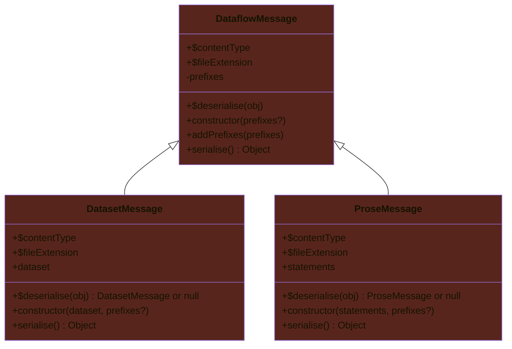
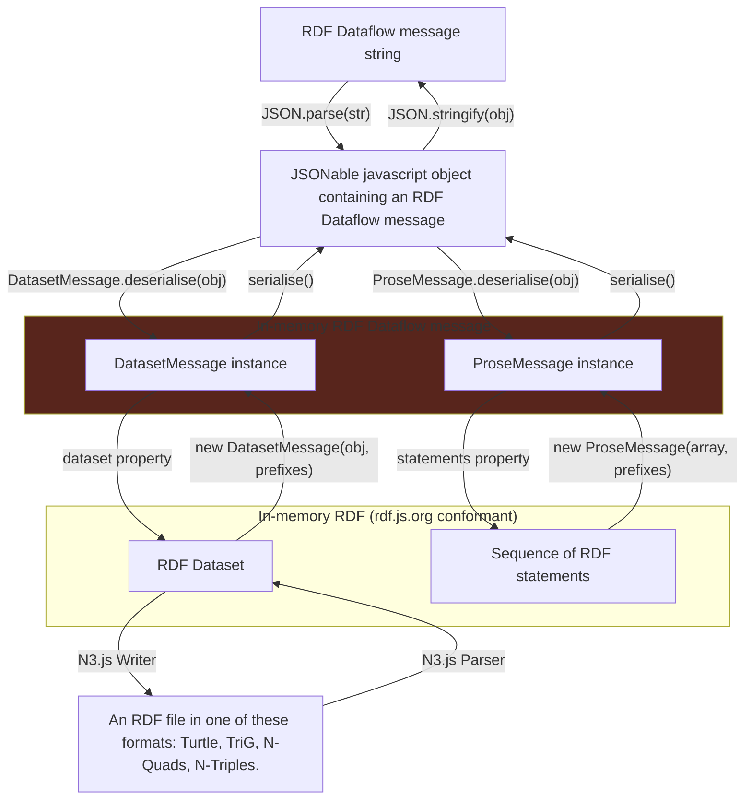

<p align="left">
<a href="https://www.w3.org/TR/rdf12-concepts/" target="_blank" rel="noreferrer"></a>
</p>

# RDF Dataflow

**RDF Dataflow** (or **Dataflow** for short) is a JSON-based message format for [RDF-star](https://graphdb.ontotext.com/documentation/11.3/rdf-sparql-star.html), which is a superset of [RDF 1.1](https://www.w3.org/TR/2014/REC-rdf11-concepts-20140225/).

RDF has a dual purpose here:

- _Data_ — It's a way of representing (semantic) data. This is the original purpose of RDF.
- _A language for machines_ — `RDF Dataflow` breaks new ground by introducing the **RDF as language** concept. RDF can serve as a new language for machines and software, mainly for those that have AI/LLM capabilities, but not only. Indeed, an RDF statement can be seen as being structured as a subject+verb+object triple, and can be converted to a human language.

Dataflow 2.x fully supports both uses of RDF:

- **Dataset mode** — A Dataflow message can contain an RDF dataset where the order of statements is not significant, and where duplicate statements are just a waste of bandwidth.
- **Prose mode** — A Dataflow message can contain prose whereby machines communicate with each other. The main use case is AI-to-AI communication. Such a message is structured as an ordered array of RDF statements, where the duplication of statements is significant.

## The Dataflow format

The `types.mts` file describes this format.

### Content type

- The generic content type for Dataflow messages is `application/x-rdfdataflow+json`, meaning that the message can contain either a dataset or prose.
- The content type for Dataflow messages containing a dataset is `application/x-rdfdataflow-dataset+json`.
- The content type for Dataflow messages containing prose is `application/x-rdfdataflow-prose+json`.

### File extension

- The generic file extension for Dataflow messages is `.rdfdataflow.json`, meaning that the message can contain either a dataset or prose.
- The file extension for Dataflow messages containing a dataset is `.rdfdataflow-dataset.json`.
- The file extension for Dataflow messages containing prose is `.rdfdataflow-prose.json`.

## Sample Dataflow messages

### A simple message containing a dataset

"<https://site.example/#jim>'s name is Jim."

```json
{
  "rdfdataflow": { "version": "3.0" },
  "dataset": [
    [
      { "type": "iri", "value": "https://site.example/#jim" },
      { "type": "iri", "value": "https://schema.org/givenName" },
      { "type": "literal", "value": "Jim" }
    ]
  ]
}
```

### A message containing a more complex dataset

Contains a statement about a statement: "<https://site.example/#hasan>'s name is Hasan. <https://site.example/#hasan>'s name is Hasan since 1999-12-25."

```json
{
  "rdfdataflow": { "version": "3.0" },
  "head": {
    "prefixes": {
      "ex"    : "https://site.example/",
      "schema": "https://schema.org/",
      "xsd"   : "http://www.w3.org/2001/XMLSchema#"
    }
  },
  "dataset": [
    [
      { "type": "iri", "value": "ex:hasan" },
      { "type": "iri", "value": "schema:givenName" },
      { "type": "literal", "value": "Hasan", "language": "tr-TR" }
    ],
    [
      { "type": "iri", "value": "ex:xyz" },
      { "type": "iri", "value": "schema:givenName" },
      { "type": "literal", "value": "سلمان", "language": "ar", "direction": "rtl" }
    ],
    [
      {
        "type": "triple",
        "value": [
          { "type": "iri", "value": "ex:hasan" },
          { "type": "iri", "value": "schema:givenName" },
          { "type": "literal", "value": "Hasan", "language": "tr-TR" }
        ]
      },
      { "type": "iri", "value": "ex:since" },
      { "type": "literal", "value": "1999-12-25", "datatype": "xsd:date" }
    ]
  ]
}
```

### A message containing prose

"<https://site.example/jimbo>'s name is Jim Bo. <https://site.example/jimbo>'s mailbox is `mailto:jim.bo@site.example`."

```json
{
  "rdfdataflow": { "version": "3.0" },
  "head": {
    "prefixes": {
      "ex"  : "https://site.example/",
      "foaf": "http://xmlns.com/foaf/0.1/",
      "xsd" : "http://www.w3.org/2001/XMLSchema#"
    }
  },
  "prose": [
    [
      { "type": "iri", "value": "ex:jimbo" },
      { "type": "iri", "value": "foaf:name" },
      { "type": "literal", "value": "Jim Bo" }
    ],
    [
      { "type": "iri", "value": "ex:jimbo" },
      { "type": "iri", "value": "foaf:mbox" },
      { "type": "literal", "value": "mailto:jim.bo@site.example", "datatype": "xsd:anyURI" }
    ]
  ]
}
```

## Dataflow compared to other RDF formats

`RDF Dataflow` is suitable whenever:

- RDF-star support is required, in particular whenever making statements about statements should be possible.
- Serialisers and deserialisers should be easy to implement.
- Document completeness (= non-truncation) should be easy to verify by examining the document contents.

Where the other RDF formats are currently falling short:

- `RDF Dataflow` breaks new ground with its prose mode. All the other RDF formats are only geared toward representing data.

- The [SPARQL 1.1 Query Results JSON Format](https://www.w3.org/TR/sparql11-results-json/) does not support RDF-star, and its purpose is to serialise many types of SPARQL results, not only RDF datasets. `RDF Dataflow` is derived from this format.

- [JSON-LD](https://www.w3.org/TR/json-ld11/) is another JSON-based format. This format ensures non-truncation, and [RDF-star support is in the works](https://json-ld.github.io/json-ld-star/), but this is a terse and human-unfriendly format for which serialisers and deserialisers are non-trivial to program.

- [Turtle](https://www.w3.org/TR/rdf12-turtle/) and [TriG](https://www.w3.org/TR/rdf12-trig/) support RDF-star, but  writing serialisers and deserialisers for those formats is non-trivial, and they make it impossible to ensure that a document hasn't been truncated, unless a special vocabulary such as [qrmm](https://vocab.qworum.net/#qrmm) is used to ensure content integrity.

- [N-Quads](https://www.w3.org/TR/rdf12-n-quads/) and [N-Triples](https://w3c.github.io/rdf-n-triples/spec/) support RDF-star, but writing serialisers and deserialisers for those formats is somewhat more difficult than for `RDF Dataflow`, and these formats also make it impossible to ensure that a document hasn't been truncated, unless a special vocabulary such as [qrmm](https://vocab.qworum.net/#qrmm) is used to ensure content integrity.

## Exported classes

This library exports 3 classes.`DataflowMessage` is an abstract root class that isn't used directly.



## How it works

This software library converts between:

- serialised `RDF Dataflow` messages
- in-memory `RDF Dataflow` messages
- in-memory `RDF` that is conformant with [the RDF/JS: Dataset specification 1.0](https://rdf.js.org/dataset-spec/#dataset-interface) and [the RDF/JS: Data model specification](https://rdf.js.org/data-model-spec/#quad-interface)

The following steps are out of scope for this library, and that's where the [N3.js](https://github.com/rdfjs/N3.js) library comes in handy:

- Writing and reading well-known RDF file formats.
- Creating in-memory RDF datasets programmatically.



## Usage example

<details data-mdrb>
<summary>In-memory dataset ➜ In-memory Dataflow message ➜ JSON ➜ In-memory Dataflow message ➜ In-memory dataset.</summary>

<pre>
description = '''
In-memory dataset ➜ Dataflow message ➜ JSON ➜ Dataflow message ➜ in-memory dataset.
'''
</pre>
</details>

```javascript
import { 
  DataflowMessage, DatasetMessage, ProseMessage 
} from 'https://cdn.jsdelivr.net/gh/doga/rdf-dataflow@3.0.0/mod.mjs';
import {
  Store, Parser, DataFactory as t
} from 'https://unpkg.com/n3@v2.13.12/browser/n3.esm.min.js';

async function run() {
  const
  parser = new Parser(),

  // Create an in-memory RDF dataset.
  datasetIn = new Store(),

  // Read statements written in Turtle format.
  statements = await parser.parse(`
    PREFIX ex: <https://site.example/>
    PREFIX schema: <https://schema.org/>
    ex:xyz schema:givenName 'Hasan'@tr. 
  `),
  
  // Create an in-memory statement.
  statement = t.quad(
    t.quad(
      t.namedNode('https://site.example/xyz'),
      t.namedNode('https://schema.org/givenName'),
      t.literal('Hasan', 'tr')
    ),
    t.namedNode('https://site.example/since'),
    t.literal('1999-12-25', t.namedNode('http://www.w3.org/2001/XMLSchema#date'))
  );
  
  // This is equivalent to `dataset.addAll([...statements, statement]);`
  datasetIn.addAll([...statements, ...statements, statement]);

  const 
  prefixes = {
    ex    : 'https://site.example/',
    schema: 'https://schema.org/',
    xsd   : 'http://www.w3.org/2001/XMLSchema#'
  },

  // Dataflow message containing a dataset.
  datasetMsg     = new DatasetMessage(datasetIn, prefixes),
  datasetMsgStr  = JSON.stringify(datasetMsg.serialise(), null, 2),
  datasetMsg2    = DatasetMessage.deserialise(JSON.parse(datasetMsgStr)),
  datasetMsgStr2 = JSON.stringify(datasetMsg2.serialise(), null, 2),

  // Dataflow message containing prose.
  proseMsg     = new ProseMessage([...statements, ...statements, statement], prefixes),
  proseMsgStr  = JSON.stringify(proseMsg.serialise(), null, 2),
  proseMsg2    = ProseMessage.deserialise(JSON.parse(proseMsgStr)),
  proseMsgStr2 = JSON.stringify(proseMsg2.serialise(), null, 2);

  console.info('Dataset message (no duplicate statements):', datasetMsgStr);
  console.info('Prose message (duplicates allowed, order preserved):', proseMsgStr);
  console.info(`Deserialisation is the reverse of serialisation for Dataset message: `, datasetMsgStr === datasetMsgStr2);
  console.info(`Deserialisation is the reverse of serialisation for Prose message: `, proseMsgStr === proseMsgStr2);
  console.group('Dataflow message:');
  console.info(`Content type:   `, DataflowMessage.contentType);
  console.info(`File extension: `, DataflowMessage.fileExtension);
  console.groupEnd();
  console.group('Dataset message:');
  console.info(`Content type:   `, DatasetMessage.contentType);
  console.info(`File extension: `, DatasetMessage.fileExtension);
  console.groupEnd();
}

await run();
```

The output of the code above:

```text
Deno 2.7.14
exit using ctrl+d, ctrl+c, or close()
> import { 
  DataflowMessage, DatasetMessage, ProseMessage 
} from 'https://cdn.jsdelivr.net/gh/doga/rdf-dataflow@3.0.0/mod.mjs';
import {
  Store, Parser, DataFactory as t
} from 'https://unpkg.com/n3@v2.13.12/browser/n3.esm.min.js';

async function run() {
  const
  parser = new Parser(),

  // Create an in-memory RDF dataset.
  datasetIn = new Store(),

  // Read statements written in Turtle format.
  statements = await parser.parse(`
    PREFIX ex: <https://site.example/>
    PREFIX schema: <https://schema.org/>
    ex:xyz schema:givenName 'Hasan'@tr. 
  `),
  
  // Create an in-memory statement.
  statement = t.quad(
    t.quad(
      t.namedNode('https://site.example/xyz'),
      t.namedNode('https://schema.org/givenName'),
      t.literal('Hasan', 'tr')
    ),
    t.namedNode('https://site.example/since'),
    t.literal('1999-12-25', t.namedNode('http://www.w3.org/2001/XMLSchema#date'))
  );
  
  // This is equivalent to `dataset.addAll([...statements, statement]);`
  datasetIn.addAll([...statements, ...statements, statement]);

  const 
  prefixes = {
    ex    : 'https://site.example/',
    schema: 'https://schema.org/',
    xsd   : 'http://www.w3.org/2001/XMLSchema#'
  },

  // Dataflow message containing a dataset.
  datasetMsg     = new DatasetMessage(datasetIn, prefixes),
  datasetMsgStr  = JSON.stringify(datasetMsg.serialise(), null, 2),
  datasetMsg2    = DatasetMessage.deserialise(JSON.parse(datasetMsgStr)),
  datasetMsgStr2 = JSON.stringify(datasetMsg2.serialise(), null, 2),

  // Dataflow message containing prose.
  proseMsg     = new ProseMessage([...statements, ...statements, statement], prefixes),
  proseMsgStr  = JSON.stringify(proseMsg.serialise(), null, 2),
  proseMsg2    = ProseMessage.deserialise(JSON.parse(proseMsgStr)),
  proseMsgStr2 = JSON.stringify(proseMsg2.serialise(), null, 2);

  console.info('Dataset message (no duplicate statements):', datasetMsgStr);
  console.info('Prose message (duplicates allowed, order preserved):', proseMsgStr);
  console.info(`Deserialisation is the reverse of serialisation for Dataset message: `, datasetMsgStr === datasetMsgStr2);
  console.info(`Deserialisation is the reverse of serialisation for Prose message: `, proseMsgStr === proseMsgStr2);
  console.group('Dataflow message:');
  console.info(`Content type:   `, DataflowMessage.contentType);
  console.info(`File extension: `, DataflowMessage.fileExtension);
  console.groupEnd();
  console.group('Dataset message:');
  console.info(`Content type:   `, DatasetMessage.contentType);
  console.info(`File extension: `, DatasetMessage.fileExtension);
  console.groupEnd();
}

await run();

Dataset message (no duplicate statements): {
  "rdfdataflow": {
    "version": "3.0"
  },
  "head": {
    "prefixes": {
      "rdf": "http://www.w3.org/1999/02/22-rdf-syntax-ns#",
      "rdfs": "http://www.w3.org/2000/01/rdf-schema#",
      "ex": "https://site.example/",
      "schema": "https://schema.org/",
      "xsd": "http://www.w3.org/2001/XMLSchema#"
    }
  },
  "dataset": [
    [
      {
        "type": "iri",
        "value": "ex:xyz"
      },
      {
        "type": "iri",
        "value": "schema:givenName"
      },
      {
        "type": "literal",
        "value": "Hasan",
        "language": "tr"
      }
    ],
    [
      {
        "type": "triple",
        "value": [
          {
            "type": "iri",
            "value": "ex:xyz"
          },
          {
            "type": "iri",
            "value": "schema:givenName"
          },
          {
            "type": "literal",
            "value": "Hasan",
            "language": "tr"
          }
        ]
      },
      {
        "type": "iri",
        "value": "ex:since"
      },
      {
        "type": "literal",
        "value": "1999-12-25",
        "datatype": "xsd:date"
      }
    ]
  ]
}
Prose message (duplicates allowed, order preserved): {
  "rdfdataflow": {
    "version": "3.0"
  },
  "head": {
    "prefixes": {
      "rdf": "http://www.w3.org/1999/02/22-rdf-syntax-ns#",
      "rdfs": "http://www.w3.org/2000/01/rdf-schema#",
      "ex": "https://site.example/",
      "schema": "https://schema.org/",
      "xsd": "http://www.w3.org/2001/XMLSchema#"
    }
  },
  "prose": [
    [
      {
        "type": "iri",
        "value": "ex:xyz"
      },
      {
        "type": "iri",
        "value": "schema:givenName"
      },
      {
        "type": "literal",
        "value": "Hasan",
        "language": "tr"
      }
    ],
    [
      {
        "type": "iri",
        "value": "ex:xyz"
      },
      {
        "type": "iri",
        "value": "schema:givenName"
      },
      {
        "type": "literal",
        "value": "Hasan",
        "language": "tr"
      }
    ],
    [
      {
        "type": "triple",
        "value": [
          {
            "type": "iri",
            "value": "ex:xyz"
          },
          {
            "type": "iri",
            "value": "schema:givenName"
          },
          {
            "type": "literal",
            "value": "Hasan",
            "language": "tr"
          }
        ]
      },
      {
        "type": "iri",
        "value": "ex:since"
      },
      {
        "type": "literal",
        "value": "1999-12-25",
        "datatype": "xsd:date"
      }
    ]
  ]
}
Deserialisation is the reverse of serialisation for Dataset message:  true
Deserialisation is the reverse of serialisation for Prose message:  true
Dataflow message:
  Content type:    application/x-rdfdataflow+json
  File extension:  .rdfdataflow.json
Dataset message:
  Content type:    application/x-rdfdataflow-dataset+json
  File extension:  .rdfdataflow-dataset.json
```

### Running the usage example

Run the code above by typing this in your terminal (requires [Deno](https://deno.com/) 2+):

```shell
deno run --allow-net --allow-run --allow-env --allow-read jsr:@andrewbrey/mdrb@3.0.4 --dax=false --mode=isolated 'https://raw.githubusercontent.com/doga/rdf-dataflow/refs/heads/main/README.md'
```

∎
